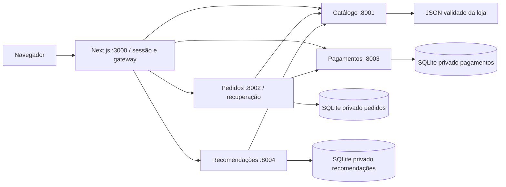
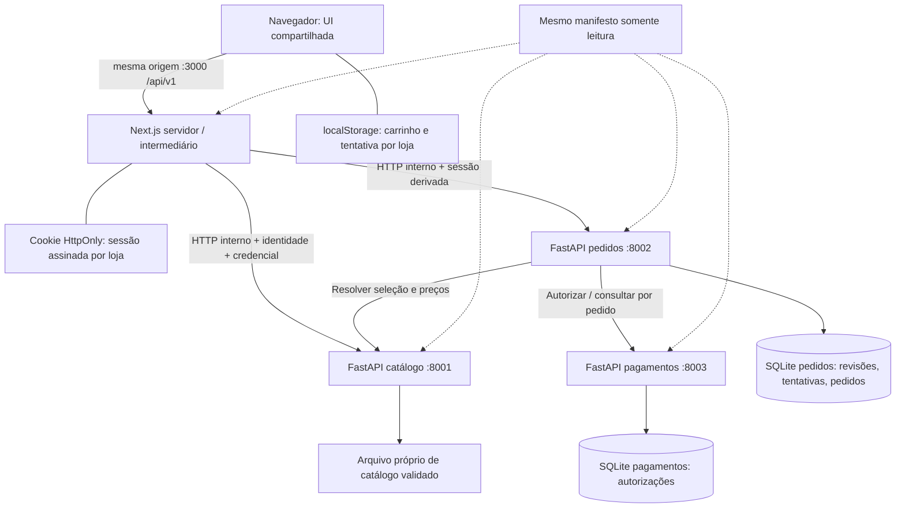
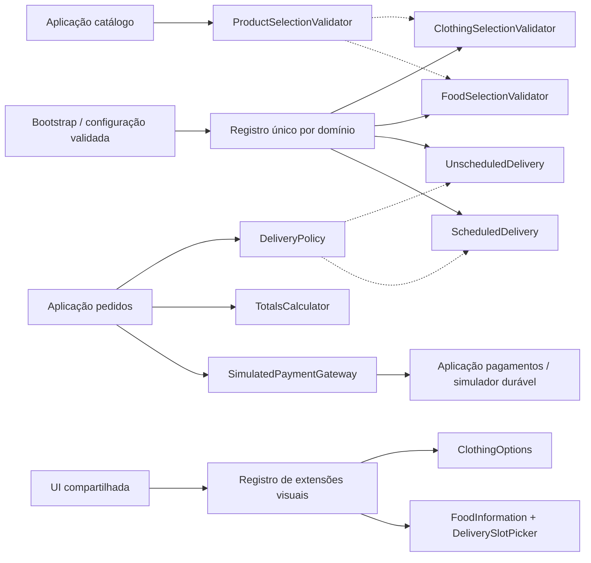

# Arquitetura atual do MVP — roupas e alimentos

## Arquitetura vigente — estabilização de 10/11/2026

Quatro microsserviços: catálogo, pedidos, pagamentos e recomendações. Next.js reúne interface e intermediário; não acessa bancos privados. O configurador visual gera os dois manifestos suportados e comandos; a aplicação do manifesto ocorre no bootstrap, sem troca durante a compra. Detalhes e evidências em [finalização da compra](finalizacao-compra-e-entrega.md).

O cliente acompanha estados intermediários por leituras limitadas e preserva a chave para retomada. O bootstrap de sessão em andamento é compartilhado entre compra e recomendações. Prontidão e testes offline não certificam execução completa do navegador.

## Registro da arquitetura dos incrementos anteriores

As seções a seguir descrevem o estado anterior à inclusão de recomendações; para arquitetura vigente, prevalece a seção acima e o documento de finalização.

Atualização 10/11/2026: [arquitetura com recomendações, quarto microsserviço e armazenamento privado](recomendacoes-e-imagens.md#arquitetura-e-componentes). Esta extensão prevalece sobre a contagem anterior de serviços neste documento.

Atualizado em 10/11/2026 após homologação real: **67 testes backend completos (HTTP/asyncio/worker), 31 offline, 10 testes web e 24 vetores de configuração aprovados**. Frontend build/lint/typecheck, E2E Next.js, navegador, instalação Python limpa e Compose continuam bloqueados. O loopback funcionou nesta execução. [Estado final e roteiro](entrega-final.md).

## Histórico identificado: revisão e migração do protótipo

No protótipo histórico, Básica/Premium representam níveis comerciais: ambas exigem catálogo/pedidos/pagamentos; Básica seleciona Pix; Premium adiciona cartão e desconto de 5% no Pix. O validador permite outros subconjuntos válidos desse eixo. Não representam roupas/alimentos. O catálogo backend é a mesma lista fixa para ambas e o frontend usa uma lista TypeScript independente.

| Ativo do protótipo conferido | Reuso planejado | Mudança necessária |
|---|---|---|
| lps/features.py | Validação antes de iniciar e mensagens de inconsistência | Modelo fechado/versionado, XOR, identidade e hash; configs antigas não aceitas no novo bootstrap |
| Pricing / RegularPrice | Contrato e centavos inteiros | Totalização de vários itens; sem desconto; frete zero |
| Payment / SimulatedPix | Separação de contrato e simulação | Incluir order_id, valor, identidade, unicidade e consulta durável |
| PixDiscount / SimulatedCard | Apenas histórico do eixo comercial | Não selecionáveis no registro do MVP |
| services/server.py | Separação lógica de responsabilidades e comunicação HTTP | Migrar handlers para três apps FastAPI; schemas estritos, dependências, lifespan, repositórios e erro comum |
| SQLite de pedidos | Armazenamento local durável e ownership | Novo schema versionado com revisões, tentativas e snapshots; banco independente de pagamentos |
| tests/test_lps.py | Ideias de restrição, cálculo, HTTP, consulta e falha de catálogo | Novos testes roupas/alimentos, concorrência, sessão e recuperação; testes atuais não provam essas capacidades |
| Next.js e packages/catalog-module | Estrutura visual e padrões de componentes | Buscar API por intermediário servidor; substituir fonte estática por DTOs e extensões de domínio |
| Dockerfile / compose.yaml | Processos separados e volume de pedidos | FastAPI/Uvicorn, frontend, volume de pagamentos, secrets, prontidão e isolamento por projeto |

Na etapa 2 não houve alteração executável. Na etapa 3, sem Git confiável, foi criado snapshot de 41 arquivos com inventário/instruções em `history/prototype-2026-11-08` antes das mudanças. Arquivos stdlib e manifestos legados permanecem para reprodução, mas o novo lançador só aceita clothing/food com schema 1. Não há checkout ativo na nova fundação.

O teste legado foi preservado sem alteração de conteúdo em `tests/legacy/test_lps.py` e no snapshot. Naquele incremento a suíte ativa era `tests/foundation`; hoje também inclui catalog, reviews e checkout. Desconto/cartão são históricos e não são critérios da nova fundação. Não há promessa de compatibilidade de API com o protótipo.

Dados antigos não são migrados automaticamente: `orders.db` sem versão, pedidos sem sessão/snapshot e catálogo TypeScript não são fontes válidas para a nova aplicação. Criar bancos novos nos caminhos por loja e rejeitar schemas desconhecidos. Fazer cópia dos dados antigos se for necessário guardá-los; não apagar nem tentar preencher dono de sessão arbitrariamente. Reinícios posteriores usam somente os bancos novos compatíveis, sem reseed destrutivo.

## Limites dos processos e armazenamento

Cada FastAPI em processo próprio, inicialmente um worker por serviço para simplificar recuperação/SQLite. Cada banco é privado do dono; chamadas internas substituem leituras cruzadas. Endereços e dados de sessão pertencem a pedidos, nunca a pagamentos. Pagamentos recebe só store_id, order_id, currency, amount_cents e método. Sem fila, broker, transação distribuída ou orquestrador extra.

Next.js é frontend/intermediário, não um quarto microsserviço de domínio. Normaliza erros, cria/valida sessão e transmite pedidos para rotas fixas; não implementa regras de preço ou autorização. Não é proxy arbitrário de URL fornecida pelo cliente. Catálogo pode manter seus arquivos em memória imutável durante execução; para alterar preço, atualizar arquivo e reiniciar catálogo. Novas revisões identificam o conteúdo por catalog_revision.

### Persistência mínima

| Dono / entidade | Campos/restrições essenciais | Política |
|---|---|---|
| pedidos / metadata | store_id, domain, storage_schema_version, config_hash de operação | Uma identidade por banco; recusar schema legado/incompatível |
| pedidos / reviews | review_id aleatório, store_id, session_owner, config_hash, entrada normalizada, snapshot, catalog_revision, created_at, expires_at | Persistida antes de devolver; 10 minutos para admissão; não apagar se referenciada por tentativa/pedido |
| pedidos / attempts | attempt_id aleatório, store_id, session_owner, idempotency_key, request_hash, corpo original, estado, resposta de rejeição, order_id, lease/version, contadores e next_retry_at | UNIQUE(store_id, session_owner, idempotency_key); sem expiração no MVP |
| pedidos / orders | order_id UUIDv4, store_id, session_owner, attempt_id, review_id, config_hash, snapshot, estado, payment_id, timestamps, versão, lease e dados de recuperação | UNIQUE(attempt_id), UNIQUE(review_id); índices por store/session; gravação transacional local |
| pagamentos / metadata | store_id, domain, storage_schema_version | Banco separado e identidade validada |
| pagamentos / authorizations | payment_id UUIDv4, store_id, order_id, amount_cents, currency, method, request_hash, estado, timestamps | UNIQUE(store_id, order_id); persistência antes de responder; sem expiração no MVP |

Sem chave estrangeira entre bancos. Em pedidos, FKs locais e transações garantem vínculo tentativa/revisão/pedido. SQLite deve usar transações curtas, `busy_timeout` limitado e fechamento explícito das conexões. Nenhuma transação fica aberta durante chamada HTTP. Locks, CAS/versionamento e restrições de unicidade tratam duplicações; lease expirado permite recuperação. Agenda é política/calendário determinístico, sem reserva: não exige banco próprio, mas cada pedido preserva sua janela.

Não descartar registros de idempotência nem de pagamento enquanto houver dados do MVP. Limpeza manual é somente reset explícito de ambiente de demonstração, nunca na troca/reinício de loja. Não há retenção produtiva definida.

## Sessão anônima e fronteira de confiança

A recepção interna autenticada de X-Session-Owner foi introduzida em 5A; a sessão assinada e o intermediário Next.js foram implementados no incremento frontend. Credencial web→pedidos continua obrigatória; cabeçalhos isolados não autorizam chamadas. Testes isolados da fronteira passaram, mas Next/navegador e E2E ainda não foram executados.

POST `/api/v1/session` cria ou reutiliza cookie de loja `lps_session_<store_id>`: SID aleatório de 32 bytes (CSPRNG), issued_at, expires_at e assinatura HMAC-SHA256 do payload, incluindo store_id. Segredo estável exclusivo da loja, fornecido ao servidor Next.js fora do manifesto. Cookie HttpOnly, SameSite=Lax, Path=/, Max-Age 30 dias; Secure em HTTPS, exceção explícita só para localhost HTTP desta demonstração. Não guardar cookie/SID no localStorage ou retornar no JSON. Perda/expiração do cookie impede recuperar pedidos daquela sessão: não há recuperação por nome/endereço ou ID isolado.

Next.js valida assinatura, loja e expiração a cada rota privada; deriva `session_owner = sha256(store_id + ':' + SID)` e transmite X-Session-Owner só para pedidos. Banco guarda o hash, não o SID bruto. Assinatura é local ao intermediário; serviços confiam no cabeçalho apenas junto à credencial interna correta. Em reinício, manter segredo e cookie para preservar o acesso. Cookie inválido em consulta não deve ser trocado silenciosamente por outra sessão e mostrar sucesso: retornar 401 SESSION_REQUIRED; interface pede iniciar nova sessão e explica a limitação.

A resposta de criação/reuso da sessão contém session_context_id, um marcador estável derivado por HMAC do SID com rótulo separado `ui-context` e store_id. Não é SID, session_owner ou credencial: não autoriza chamadas e nunca substitui o cookie. O navegador grava esse marcador junto à tentativa para detectar perda/troca de sessão antes de reenviar; contexto diferente bloqueia reenvio da tentativa antiga, evitando que um 404 sob nova sessão seja interpretado como ausência da compra original.

Cabeçalhos do navegador X-Session-Owner, X-Store-Id, X-Config-Hash e Authorization não são encaminhados: o intermediário os recria a partir da configuração/cookie. Rotas mutantes exigem Origin exato configurado, JSON e cookie válido (exceto criação da sessão). Origin ausente/incorreto é 403. Navegador não fornece identidade da sessão no corpo. Sem CORS permissivo nos serviços.

Credenciais aleatórias por loja e por relação de chamada: Web→catálogo, Web→pedidos, pedidos→catálogo, pedidos→pagamentos; Web→pagamentos apenas readiness. Bearer em variáveis de servidor/segredos, não NEXT_PUBLIC_*, não em manifesto público, localStorage ou logs. Catálogo distingue credencial somente-leitura do Web e resolução de seleção por pedidos. Serviços de escrita rejeitam acesso direto não autenticado. Em Compose, backends não publicam portas; sem Docker, loopback + credenciais. Esse é um limite local proporcional, não uma alegação de prontidão para internet.

Pedidos filtra toda leitura por store_id **e** session_owner; ID não previsível não substitui autorização. ID de outro dono retorna o mesmo 404 de inexistente, inclusive revisão e tentativa. A API de pagamento nunca fica disponível diretamente ao navegador; pedido expõe apenas status e ID do próprio pagamento. Respostas de sessão/pedidos/revisão têm Cache-Control: no-store; nenhum cache compartilhado de dados privados.

## Contratos dos componentes de domínio

Contratos de catálogo/seleção/entrega/totais têm implementações em domain/ desde a etapa 4 e são reutilizados por revisão 5A. O gateway tipado de pagamentos e a autorização simulada durável estão implementados em services/orders/payment_client.py e services/payments/. O cliente tipado de catálogo e a persistência de revisão estão descritos no guia 5A.

| Componente | Responsabilidade; entradas → saídas | Implementações previstas | Uso/seleção | Validação futura |
|---|---|---|---|---|
| ConfigurationValidator | Manifesto bruto → ValidatedStoreConfig + hash ou erros com caminho | StoreConfigV1Validator único, regras de ambos os domínios | Bootstrap dos quatro processos; schema versionado | Vetores de hash e configs válidas/inválidas T01 |
| CatalogLoader | Manifesto + arquivo do dono → catálogo imutável + revision ou erros | ClothingCatalogValidator / FoodCatalogValidator | Catálogo; registro por domínio no bootstrap | Dados incompletos, IDs repetidos, alergênicos e combinações T02–T04 |
| ProductSelectionValidator | Produto atual + selection(product_id, combination_id?, quantity) → ResolvedItemSnapshot ou SelectionError | ClothingSelectionValidator / FoodSelectionValidator | Dentro de catálogo; roupas exige combinação habilitada do produto, alimento proíbe combination_id | Combinação inválida/desabilitada, unidade, limites e campos extras T03/T04/T07 |
| DeliveryPolicy | Endereço + slot_id? + relógio + política → DeliverySnapshot ou erro; list_slots(now) → janelas | UnscheduledDelivery / ScheduledDelivery | Pedidos; registro por domínio | Sem agendamento em roupas; futuro, habilitação, fuso e reinício T06/T11 |
| TotalsCalculator | Lista resolvida com quantidades → linhas, subtotal/total, frete=0, desconto=0, BRL | IntegerTotalsCalculator único | Pedidos na revisão e admissão; centavos sem floats | Soma, overflow/limites de contrato, preço alterado T07/T08 |
| SimulatedPaymentGateway | authorize(store, order, amount, currency) e lookup(store, order) → PaymentResult ou erro transitório/conflito | HttpSimulatedPixGateway no cliente; DurableSimulatedPixAuthorizer no serviço | Pedidos usa porta; pagamentos executa simulador e repositório | Uma autorização durável por pedido, mesmo/diferente valor, timeout T09–T12 |

TotalsCalculator não consulta catálogo nem autoriza pagamento. Gateway não é responsável por gravar pedido. Repositórios fornecem transações e unicidade; o serviço de aplicação coordena contratos sem virar um novo microsserviço. Substituir implementação exige registrar uma compatível no ponto de composição e passar testes do contrato; não criar features adicionais para justificar substituição.

### Componentes visuais e composição

ProductCard/ProductList, ProductDetails, Cart, AddressForm, Checkout, OrderSummary e OrderLookup são comuns. ClothingOptions recebe combinações válidas e emite combination_id. FoodInformation recebe metadados estruturados e diferencia alergênicos desconhecidos de ausentes. DeliverySlotPicker recebe janelas do servidor e emite slot_id. CartStore usa localStorage com namespace da loja; não guarda autoridade de preço/sessão. Testes Node cobrem funções de carrinho e fronteira web; renderização React e fluxo no navegador ainda não foram verificados.

Componente de domínio é unidade de comportamento com contrato; componente visual é unidade de apresentação/interação; microsserviço é processo implantável com API e dados próprios. Compartilhar bibliotecas não concede acesso direto ao banco de outro serviço. Condicional de seleção fica concentrada no registro/bootstrap; componentes de uso comum recebem abstrações e DTOs discriminados, com tratamento de variante apenas na fronteira de apresentação/validação.

## Histórico identificado: migração por etapas

Apps FastAPI separadas, configuração estrita, lifespan e erros comuns foram materializados na etapa 3; naquele momento OpenAPI tinha somente saúde/prontidão implementadas. Versões efetivamente utilizadas estão no guia da fundação/requirements. Catálogo de negócio e DTOs de compra serão implementados depois; não expor automaticamente essas APIs pelo intermediário.

Etapa 3 criou esqueleto/schema/ambiente; etapa 4 acrescentou catálogo imutável validado, APIs internas e componentes puros definidos acima (exceto pagamento). O registro de composição fica em domain/composition.py e as permissões em foundation/auth.py. No fechamento da etapa 4 totais/entrega eram apenas componentes; 5A agora publica janelas e usa totais na revisão. Compra/recuperação foram implementadas em 5B; frontend/sessão no incremento seguinte. Build frontend e Compose continuam não verificados.

Na **etapa 5A**, pedidos usa CatalogClient tipado por HTTP para resolver seleções, reutiliza entrega/totais, grava revisão por INSERT em transação curta e publica as janelas pelo componente existente. O schema continua versão 1, sem migração/limpeza; nenhum HTTP acontece dentro da transação. Naquele incremento ainda não existiam consumo/admissão/pagamento/worker, que foram acrescentados em 5B. Pedidos voltou a depender de pagamentos com token específico e frontend integrado no código posteriormente. Componentes de entrega foram preservados.
