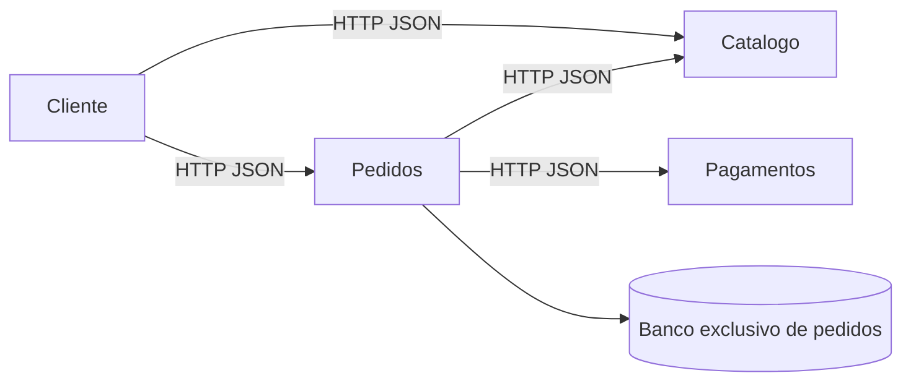

# Histórico — modelagem do protótipo Básica/Premium

> Histórico do protótipo, preservado em 08/11/2026. Não usar este modelo como contrato do MVP roupas/alimentos. A arquitetura-alvo atual está em [arquitetura-atual.md](arquitetura-atual.md) e o modelo de features em [modelo-lps.md](modelo-lps.md). O conteúdo abaixo registra decisões anteriores, inclusive pagamentos sem persistência e consulta por ID que serão substituídos; as novas regras ainda não estão implementadas.

## Decisão de escopo: agentes de IA

Agentes de IA são opcionais e não serão incluídos inicialmente. As variantes Básica e Premium funcionam sem agentes, modelos de IA ou serviços externos de IA. A inclusão futura depende de uma nova decisão de escopo; não constitui requisito nem feature da versão atual.

## Modelo de domínio

A engenharia de domínio identifica catálogo, pedidos e pagamentos como núcleo comum. A engenharia de aplicação deriva lojas selecionando features nos arquivos de `configurations`, sem copiar os serviços. A seleção ocorre na inicialização e exige reinício para mudar a variante.

```text
E-commerce
├── Catálogo (obrigatório)
├── Pedidos (obrigatório)
├── Pagamentos (obrigatório)
│   └── Meios (OR: um ou mais)
│       ├── Pix
│       └── Cartão
└── Desconto Pix de 5% (opcional; requer Pix)
```

Features desconhecidas, duplicadas, ausência de features obrigatórias ou de meios de pagamento são rejeitadas.

| Feature | Básica | Premium | Implementação |
|---|---|---|---|
| Catálogo | Sim | Sim | serviço catalog |
| Pedidos | Sim | Sim | serviço orders |
| Pagamentos | Sim | Sim | serviço payments |
| Pix | Sim | Sim | componente SimulatedPix |
| Cartão | Não | Sim | componente SimulatedCard |
| Desconto Pix | Não | Sim | componente PixDiscount |



Cada serviço executa em processo/container próprio com porta independente. Compartilham imagem e componentes, mas não acessam o armazenamento uns dos outros. O catálogo usa dados demonstrativos em memória; pagamentos é sem estado; pedidos possui SQLite persistente.

Os contratos `Pricing` e `Payment` em `lps/components.py` permitem composição de implementações substituíveis por fábricas. Um componente é uma unidade reutilizável dentro do processo; um microsserviço é uma unidade de implantação. Preço regular/desconto e Pix/cartão são os pontos de variação implementados.

| Serviço | Endpoint | Contrato |
|---|---|---|
| Todos | GET /health | Serviço, produto e features |
| catalog :8001 | GET /products | Catálogo com preço em centavos |
| orders :8002 | POST /orders | product_id, quantity, payment_method; retorna 201 |
| orders :8002 | GET /orders/{id} | Pedido persistido ou 404 |
| payments :8003 | POST /payments | method, amount_cents; autorização simulada |

Dados inválidos retornam 400; dependências indisponíveis retornam 503 após timeout. Pedidos consulta o preço no catálogo e calcula o total no servidor, com valores inteiros em centavos.

## Limites e próximos incrementos

Protótipo acadêmico: pagamentos simulados, sem autenticação, estoque, frete, idempotência ou transação distribuída. Uma falha entre autorização e gravação exige reconciliação em uma versão real. A vitrine Next.js original ainda usa o catálogo TypeScript local e não consome essas APIs. Os dados Python são demonstrativos.

Próximos incrementos: conectar a vitrine às APIs, adicionar carrinho e checkout, reserva de estoque e compensação, autenticação e pagamentos idempotentes. Novas features devem incluir restrições, implementação e testes de derivação. Para lojas isoladas, use bancos/volumes distintos; alternar a configuração mantém os pedidos existentes.
