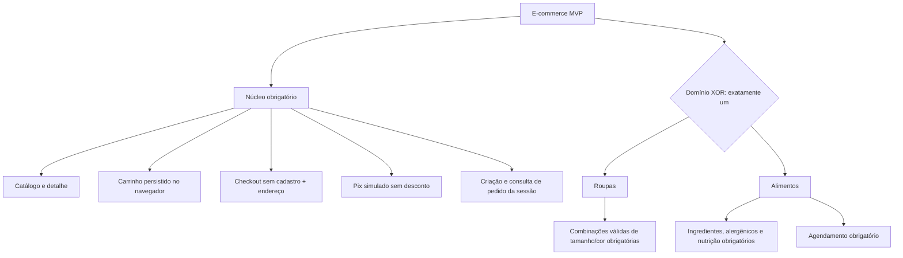

# Modelo detalhado da LPS e derivação

Extensão 10/11/2026: recomendações é capacidade comum fixa, sem toggle no manifesto v1; o item 6.1 do roteiro de relatório posteriormente fornecido exige essa capacidade em microsserviço próprio. As variantes continuam roupas/alimentos, exclusivas. Veja [decisão e componentes](recomendacoes-e-imagens.md).

Atualizado em 10/11/2026 após homologação real: **67 testes backend completos (HTTP/asyncio/worker), 31 offline, 10 testes web e 24 vetores de configuração aprovados**. Frontend build/lint/typecheck, E2E Next.js, navegador, instalação Python limpa e Compose continuam bloqueados. O loopback funcionou nesta execução. [Estado final e roteiro](entrega-final.md).

## Limite acadêmico e vocabulário

O professor exige modelar/implementar uma LPS, utilizar microsserviços e componentes. Python é sugerido; IA é opcional. Dois domínios, tecnologias, três serviços, formato de configuração, diagramas e testes são decisões deste projeto, não novas exigências acadêmicas.

Feature de produto é uma capacidade observável da família, como seleção de tamanho/cor ou agendamento. FastAPI, SQLite, HTTP, cookies, componentes React, hash de configuração e Docker Compose são escolhas de implementação. Não são alternativas de produto no modelo.

## Features e restrições

Não há features opcionais desligáveis no MVP. As capacidades comuns são obrigatórias; as capacidades de domínio são obrigatórias **condicionadas à alternativa escolhida**. Ausência em outra alternativa não as torna opcionais. Cartão, desconto, IA e estoque estão fora da família ativa desta versão, não em um grupo de opções.



Regras formais (nomes usados na configuração):

- Núcleo `K = {catalog, cart, checkout, orders, simulated_pix, address_delivery}` sempre selecionado.
- `domain ∈ {clothing, food}`, exatamente um valor escalar.
- `clothing ⇒ features = K ∪ {size_color_selection}`.
- `food ⇒ features = K ∪ {food_information, delivery_scheduling}`.
- `size_color_selection` exclui `food_information` e `delivery_scheduling`; estas duas implicam `food` e são inseparáveis nesta versão.
- A lista não admite duplicatas, desconhecidos nem seleção parcial do núcleo. `delivery_policy` deve ser `unscheduled` em roupas e `scheduled` em alimentos; ambos têm endereço e frete zero.

| Capacidade | Roupas | Alimentos | Natureza |
|---|---|---|---|
| Catálogo, detalhe, carrinho, checkout e pedidos | Sim | Sim | Obrigatória comum |
| Endereço simples, sem frete calculado | Sim | Sim | Obrigatória comum |
| Pix simulado, sem desconto | Sim | Sim | Obrigatória comum |
| Tamanho/cor por combinação | Sim | Não | Obrigatória em roupas |
| Ingredientes/alergênicos/nutrição | Não | Sim | Obrigatória em alimentos |
| Janela futura de entrega | Não | Sim | Obrigatória em alimentos |
| Feature opcional desligável | Nenhuma | Nenhuma | Não existe no MVP |

## Rastreabilidade das features

| Feature | Interface compartilhada/extensão | Serviço dono | Componente | Testes previstos |
|---|---|---|---|---|
| catalog | ProductList, ProductCard, ProductDetails | catálogo | CatalogLoader e SelectionValidator | T02, T03, T04 |
| cart | Cart e resumo | frontend local | CartStore | T05, T14 |
| checkout/address_delivery | Checkout e AddressForm | pedidos | DeliveryPolicy | T06, T07 |
| orders | OrderConfirmation e OrderLookup | pedidos | OrderApplication, repositórios | T08–T13, T15 |
| simulated_pix | Aviso de simulação e estado | pagamentos | SimulatedPixAuthorizer | T08–T12 |
| size_color_selection | ClothingOptions | catálogo | ClothingSelectionValidator | T03 |
| food_information | FoodInformation | catálogo | FoodCatalogValidator | T04 |
| delivery_scheduling | DeliverySlotPicker | pedidos | ScheduledDelivery | T06, T11 |

Os IDs de cenários e requisitos estão definidos apenas em [validacao.md](validacao.md).

## Configuração documental completa: roupas

Manifesto ativo: [configurations/clothing.json](../configurations/clothing.json), criado na etapa 3.

```json
{
  "schema_version": 1,
  "store_id": "roupas-demo",
  "display_name": "Loja de Roupas Demo",
  "domain": "clothing",
  "currency": "BRL",
  "timezone": "America/Sao_Paulo",
  "features": ["catalog", "cart", "checkout", "orders", "simulated_pix", "address_delivery", "size_color_selection"],
  "catalog": {
    "dataset_id": "clothing-demo-v1",
    "schema_version": 1,
    "source": "demo-data/clothing/products.json"
  },
  "delivery": {
    "policy": "unscheduled",
    "shipping_cents": 0
  },
  "payment": {
    "provider": "simulated_pix",
    "discount_cents": 0
  }
}
```

## Configuração documental completa: alimentos

Manifesto ativo: [configurations/food.json](../configurations/food.json), criado na etapa 3.

```json
{
  "schema_version": 1,
  "store_id": "alimentos-demo",
  "display_name": "Loja de Alimentos Demo",
  "domain": "food",
  "currency": "BRL",
  "timezone": "America/Sao_Paulo",
  "features": ["catalog", "cart", "checkout", "orders", "simulated_pix", "address_delivery", "food_information", "delivery_scheduling"],
  "catalog": {
    "dataset_id": "food-demo-v1",
    "schema_version": 1,
    "source": "demo-data/food/products.json"
  },
  "delivery": {
    "policy": "scheduled",
    "shipping_cents": 0,
    "schedule": {
      "policy_id": "food-windows-v1",
      "days_ahead": 7,
      "daily_windows": [
        {"id": "morning", "start": "09:00", "end": "12:00", "enabled": true},
        {"id": "afternoon", "start": "14:00", "end": "17:00", "enabled": true}
      ]
    }
  },
  "payment": {
    "provider": "simulated_pix",
    "discount_cents": 0
  }
}
```

Não há segredos, URLs de serviços nem caminhos de banco nesses manifestos. Caminhos de catálogo são relativos à raiz empacotada; somente catálogo lê esses arquivos. Outros processos validam a referência, não abrem dados privados do serviço.

## Validação e exemplos inválidos

Objeto fechado: campos extras são rejeitados. Tipos estritos; bool não é inteiro; versões suportadas iguais a 1; store_id com 3–40 caracteres `[a-z0-9-]`; nome com 1–80 caracteres; domínio enumerado; moeda/fuso fixos; features com conjunto exato do domínio. Sem defaults silenciosos que transformem um domínio no outro. Ajuste técnico da etapa 3: números são inteiros matemáticos conforme JSON Schema (a notação 1.0 normaliza para 1, frações são recusadas), garantindo paridade com JSON.parse. Strings com controles/surrogates isolados são recusadas. O schema comum e regras semânticas de caminhos/janelas são verificados nos dois runtimes; a implementação TS cobre somente as palavras-chave usadas pelo schema comprometido, não é um validador genérico Draft-7.

Catálogo exige dataset_id, schema_version e caminho sem travessia `..` nem caminho absoluto. O serviço catálogo valida propriedade da loja/domínio, IDs únicos, produtos completos e valores positivos na carga. Revisão do conteúdo do catálogo é calculada separadamente; não integra o hash do manifesto, permitindo alterar preço mantendo a identidade da loja.

Em alimentos, agenda contém days_ahead inteiro 1–7, IDs de janela únicos, HH:mm válidos, início menor que fim no mesmo dia, sem sobreposição. Apenas enabled true é oferecido. days_ahead inclui hoje e os próximos seis dias quando igual a 7; hoje só inclui inícios estritamente futuros. ID concreto contém policy_id, data local e id da janela; validar contra a política atual, não aceitar horários enviados pelo navegador. Sem capacidade, estoque ou reserva. Em roupas, `schedule` deve estar ausente.

| Exemplo de alteração em um manifesto válido | Resultado esperado |
|---|---|
| Usar `domain: ["clothing", "food"]` | Inválido: XOR e tipo escalar |
| Remover size_color_selection de roupas | Inválido: capacidade obrigatória do domínio |
| Adicionar delivery_scheduling a roupas | Inválido: exclusão |
| Remover food_information de alimentos | Inválido: não é opcional |
| Trocar payment.provider para card ou adicionar discount | Inválido: fora do MVP |
| Repetir catalog ou remover orders | Inválido: duplicação/núcleo incompleto |
| Definir schedule em unscheduled | Inválido: contrato de domínio |
| Apontar alimentos para dataset marcado clothing | Manifesto estrutural pode passar; catálogo falha na validação de dados e não fica pronto |
| Abrir banco de roupas com store_id alimentos-demo | Serviço de pedidos/pagamentos não inicia pronto; nunca corrige ou limpa dados automaticamente |

## Aplicação, identidade e consistência

Aplicar configuração em inicialização, antes de prontidão; sem troca por parâmetro do navegador, hot reload ou multitenancy. Derivação = validar manifesto → escolher registro de componentes do domínio → carregar ativos do serviço → validar armazenamento/identidade → verificar dependências → expor prontidão. O frontend usa mapa único de extensões por domínio, não condicionais dispersas em páginas.

`config_hash = sha256` em hexadecimal dos bytes UTF-8 da representação JSON canônica do manifesto: objetos com chaves em ordem lexicográfica, sem espaços, strings Unicode sem escapes desnecessários, sem floats, features ordenadas lexicograficamente na normalização; demais arrays mantêm ordem. Mesmo artefato é fornecido aos quatro processos. Uma implementação de referência Python e testes com vetores de hash para TypeScript evitam interpretações diferentes; o hash não é segredo nem assinatura.

Toda chamada interna inclui X-Store-Id e X-Config-Hash junto à credencial. Respostas e readiness informam identidade. Mismatch → 409 CONFIG_MISMATCH, prontidão agregada 503; nunca usar outra loja como fallback. Web compara os três serviços; pedidos compara catálogo/pagamentos. Configuração pública é uma projeção segura do manifesto local, publicada somente com identidade coerente. Navegador invalida revisão se o hash mudar; a chamada interna também protege contra abas antigas.

Isolamento: projeto Compose por loja; volumes nomeados por projeto; caminhos locais `var/<store_id>/orders.sqlite` e `payments.sqlite`; metadados do banco com store_id, domain e storage_schema_version. Registros também guardam store_id. Não selecionar banco pelo corpo da requisição. Serviços têm acesso exclusivo a seus volumes; segredo interno e segredo de sessão por loja fora do manifesto, estáveis entre reinícios. Nunca compartilhar volume de pedidos com pagamentos.

Carrinho: chave `lps:cart:v1:<store_id>`, contendo store_id, domain, config_hash e itens (product_id, combination_id quando roupa, quantidade). Nada de endereço, cookie ou credencial no localStorage. Ao recarregar, comparar identidade/schema e revalidar catálogo antes de revisar. Se hash mudou, pedir nova seleção/revisão; não migrar silenciosamente. Ao alternar loja, não carregar carrinho da outra. Preço local é só exibição, nunca autoridade. Limpeza obedece [recuperacao.md](recuperacao.md).

Reiniciar a mesma loja reutiliza bancos, projeto/volumes e segredos, sem gerar uma nova identidade. Banco compatível mantém pedidos, autorizações, tentativas e revisões. Mudança de domain/store_id é recusada. Atualização compatível de manifesto preserva snapshots, mas invalida novas compras com revisões do hash antigo. Para este MVP, bloquear mudança de manifesto se houver tentativas/pedidos intermediários do hash anterior; voltar à configuração anterior, recuperar e concluir antes de alterar. Não reinterpretar transações antigas sob políticas novas.

## Derivação executável e partes ainda especificadas

O lançador `tools/lps.py` aceita clothing/food, conserva segredos e injeta o catálogo correto somente no processo dono. Configuração e carga são validadas antes de servir; TypeScript valida a mesma identidade. Registro de componentes em domain/composition.py concentra seleção de roupa/alimento e entrega. Frontend permanece legado e sem carrinho. Sem NEXT_PUBLIC_* para seleção ou segredo; subir Next.js/Compose ainda depende das pendências registradas no guia atual.

Execução local implementada: três apps `services.catalog.app:app`, `services.orders.app:app`, `services.payments.app:app`, com as mesmas portas previstas; bancos em `var/<store_id>/<service>/<service>.sqlite`. Os comandos exatos e a separação de credenciais constam apenas no guia da fundação para evitar versões divergentes.

Compose escrito, não executado: quatro processos, manifesto read-only e volumes privados; só frontend publica porta. A pasta demo-data agora é montada read-only somente em catalog. O conteúdo é validado contra store_id/domain/dataset do manifesto. Projetos por loja mantêm isolamento; timezone permanece regra de domínio, não fuso do host.
