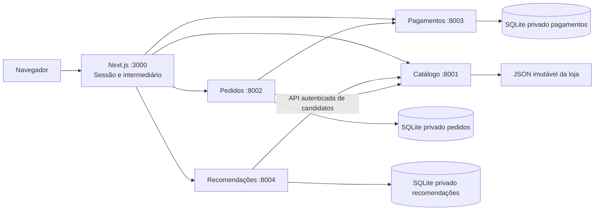

# Imagens e recomendações — incremento de 10/11/2026

## Implementação

O catálogo de roupas contém dez produtos fictícios, com fotografias ilustrativas locais: camiseta, calça de sarja, jaqueta leve, vestido midi, bermuda de moletom, moletom com capuz, camisa de linho, blazer de alfaiataria, saia plissada e cardigã. Os seis IDs originais, preços e combinações foram preservados. Categorias foram agrupadas para permitir recomendações relacionadas. Alimentos mantém seis produtos.

`ProductMedia` usa os PNGs de `apps/store-ropa/public/demo/clothing/` e apresenta a ilustração SVG autoral caso uma imagem falhe. As fotos ilustram a peça, não todas as combinações nem disponibilidade física. Não há estoque. Os arquivos são servidos pelo Next.js em `/demo/clothing/<id>.png`, sem dependência de rede externa.

A interface mantém catálogo, carrinho e compra existentes. A nova seção permite escolher categorias, cores, tamanhos, preço máximo e uso do histórico; mostra até seis recomendações, com justificativas, e abre os detalhes existentes. Em alimentos, cores/tamanhos não são oferecidos. Falha das recomendações não impede a compra.

## Arquitetura e componentes

Há agora quatro microsserviços FastAPI e um frontend Next.js, em cinco processos. Recomendações é uma extensão comum fixa do projeto, exigida pelo item 6.1 do roteiro de relatório posteriormente fornecido, sem ser feature opcional configurável. Não há IA em execução. Manifestos v1 e seus hashes não mudam; não se inventa um toggle que o código não permite desligar.



`ranking.py` é componente puro e determinístico; `CandidatesClient` obtém candidatos pela API, sem ler arquivos privados do catálogo; `RecommendationService` coordena validação e persistência; `RecommendationsRepository` mantém o banco privado. Nenhuma transação SQLite permanece aberta durante HTTP. Prontidão verifica configuração, banco e catálogo; liveness permanece independente.

O algoritmo `content-v1` atribui pontos a categoria (+6), cor (+3), tamanho (+2) e afinidade de categoria no histórico (visualização +1, carrinho +2, limitada a 6). Um produto já visto recebe -2. Preço máximo é limite rígido; tamanho e cor devem coexistir na mesma combinação habilitada. Sem combinação habilitada, a peça não é sugerida. Empates usam ID, garantindo repetibilidade. Histórico de produtos removidos é ignorado. Sem sinais, há descoberta determinística. Não há filtragem colaborativa, perfil de terceiros, treinamento ou recomendação médica/alimentar.

## Sessão, persistência e controle

Preferências e os últimos 100 eventos por sessão/loja ficam em `var/<store_id>/recommendations/recommendations.sqlite`. O banco usa os controles de identidade, schema v1, unicidade e transações da fundação. Não lê pedidos nem pagamentos. Eventos usam UUID v4; repetir ID/conteúdo é idempotente, reutilizar ID com conteúdo diferente retorna conflito. A sessão anônima limita a identidade: apagar/expirar o cookie perde acesso ao perfil anterior; isso não é conta de usuário.

Desativar histórico apaga os eventos; limpar preferências/histórico também pausa a coleta. Novas interações só são guardadas se habilitadas. Os eventos são visualizações e adições ao carrinho, não dados bancários ou endereço. O intermediário reconstrói credenciais e dono da sessão; o navegador não controla esses cabeçalhos.

## Contratos adicionados

Todas as rotas abaixo usam o intermediário privado, `Cache-Control: no-store`, sessão assinada, identidade da loja/hash e validação estrita. Mutações exigem mesma origem. O corpo não aceita dono de sessão. O prefixo público é `/api/v1`; o serviço usa `/internal/v1`, com os mesmos sufixos:

| Método e sufixo | Entrada/saída |
|---|---|
| GET `/preferences` | loja, perfil, opções permitidas e contagem do histórico |
| POST `/preferences` | store_id, categories/colors/sizes (até 12 únicos), max_price_cents inteiro ou null, use_history booleano; retorna perfil |
| GET `/recommendations` | loja, catalog_revision, algorithm_version, mode e itens com reasons |
| POST `/recommendation-events` | store_id, event_id UUID v4, product_id, kind view ou add_to_cart; retorna saved |
| POST `/recommendation-reset` | store_id; retorna cleared=true |

Exemplo de preferências: `{"store_id":"roupas-demo","categories":["Camisetas e camisas"],"colors":[],"sizes":[],"max_price_cents":15000,"use_history":true}`. Valores de opções devem vir do GET, não de uma lista fixa no cliente. Campos extras, opções inexistentes e atributos de roupa em alimentos são rejeitados.

A rota exclusiva catálogo GET `/internal/v1/recommendation-candidates` exige `RECOMMENDATIONS_CATALOG_TOKEN`; web e pedidos não têm essa permissão. O serviço de recomendações aceita apenas `WEB_RECOMMENDATIONS_TOKEN` com `X-Session-Owner` válido. Clientes tipados validam envelope, domínio e identidade. Timeout de 1,5 s por tentativa; no máximo duas tentativas em falhas transitórias, intervalo de 0,1 s, sem encaminhamento por redirecionamentos. Erros usam envelope comum; armazenamento indisponível retorna 503 e ID de evento reutilizado retorna 409.

## Executar

Em PowerShell, na raiz do projeto:

```powershell
.\.venv\Scripts\python.exe tools/lps.py init clothing
.\.venv\Scripts\python.exe tools/lps.py run clothing --dev
# Abra http://127.0.0.1:3000; encerre com Ctrl+C antes de trocar.
.\.venv\Scripts\python.exe tools/lps.py init food
.\.venv\Scripts\python.exe tools/lps.py run food --dev
```

O init acrescenta as duas novas credenciais a arquivos locais antigos válidos, preservando os seis segredos anteriores e SESSION_SECRET. Não publicar `.local`, não apagar bancos para atualizar. Recomendações isoladamente: `python tools/lps.py service clothing --service recommendations`. Portas locais: frontend 3000, catálogo 8001, pedidos 8002, pagamentos 8003, recomendações 8004. Compose inclui serviço e volume privados adicionais, sem publicar sua porta; somente catálogo monta seus dados de catálogo.

## Validação e limites

Executados: **43 testes backend offline**, **13 testes da fronteira web**, **24 vetores de configuração**, typecheck, lint e validação de DTOs Python/TypeScript. As imagens PNG existentes e as dez peças são verificadas. Testes cobrem ranking, combinações reais, preferências estritas, orçamento, histórico, idempotência, persistência/reinício e isolamento, autenticação e cliente tipado.

Os testes HTTP novos estão escritos, mas a suíte completa e E2E não executaram nesta sessão porque o preflight de loopback/asyncio falhou. Build Next.js tentou executar e falhou no SWC por acesso negado ao resolver jsc.baseUrl. Docker/Compose, instalação Python limpa e inspeção visual em navegador continuam não verificados. Testes offline e checagem de tipos não substituem essas verificações. O relatório local `.local/validation-latest.json` registra os resultados; não há declaração de homologação completa.

Resultados antigos de 67 testes completos descrevem uma revisão anterior, não este incremento. PDFs/relatórios anteriores que apresentam três microsserviços e ausência de recomendações são históricos e precisam ser atualizados antes de nova entrega acadêmica.

## Origem das imagens

Dez imagens novas foram geradas pelo recurso nativo de geração de imagens, modo geração individual, sem API externa em execução no projeto e sem cópia de fotografia de terceiros. São ilustrações sintéticas, não fotos de mercadorias reais. Caminho salvo: `apps/store-ropa/public/demo/clothing/<id>.png`.

Prompt-base utilizado (inglês): “Generate a single photorealistic ecommerce product photograph for a fictional academic clothing store. [subject] Neatly centered and completely visible, invisible mannequin or flat lay with natural volume. Warm pale off-white studio background, soft natural light, subtle realistic shadow, premium minimalist fashion catalog style. Square composition with generous margins. No model, no human body, no logos, no text, no watermark, no props. This is one independent product image intended for {id}.png in the repository.”

| ID / arquivo PNG | Subject inserido |
|---|---|
| camiseta | plain black essential cotton crew-neck short-sleeve T-shirt |
| calca-sarja | beige straight-leg cotton twill trousers, button/pockets |
| jaqueta-leve | lightweight olive green zip casual jacket, no hood |
| vestido-midi | burgundy short-sleeve midi dress waist seam flowing skirt |
| bermuda-moletom | medium gray cotton fleece drawstring shorts |
| moletom-capuz | navy hooded sweatshirt kangaroo pocket |
| camisa-linho | offwhite linen long-sleeve buttondown shirt relaxed collar |
| blazer-alfaiataria | charcoal gray tailored two-button blazer lapels |
| saia-plissada | beige pleated midi skirt |
| cardiga-tricot | cream knitted V-neck button cardigan |

## Preservação

O `pip check` também identificou conflito no ambiente instalado: `streamlit-vis-network 0.1.3` exige `setuptools>=75.8.0`, enquanto há `65.5.0`. Essa biblioteca não foi adicionada por este incremento. As versões das dependências fixadas do projeto conferem, mas isso não equivale a instalação limpa nem aprovação do ambiente completo. Não foram alteradas dependências globais para contornar o problema.

| Requisito do incremento | Evidência atual | Validação ainda necessária |
|---|---|---|
| Dez peças e imagens locais com fallback | Teste dos arquivos e carga dos dois catálogos aprovado | Inspeção de renderização em navegador |
| Preferências, combinações e orçamento | Ranking puro e modelos estritos aprovados | Jornada completa no navegador |
| Histórico limitado, limpeza e isolamento | Repositório temporário, reinício e autenticação aprovados | HTTP real entre os processos novos |
| Intermediário sem credenciais no cliente | 13 testes web e contratos tipados aprovados | E2E com Next.js executando |
| Ambiente com serviço e volume privados | Código de bootstrap e lançador verificados por testes offline | Compose e instalação independente |

Antes de editar, 102 fontes foram preservadas em `history/before-recommendations-2026-11-10`, com inventário SHA256. Não havia repositório Git. Segredos, bancos e node_modules não foram copiados. Histórico não é produto ativo. Nenhum banco de demonstração foi usado pelos testes.
