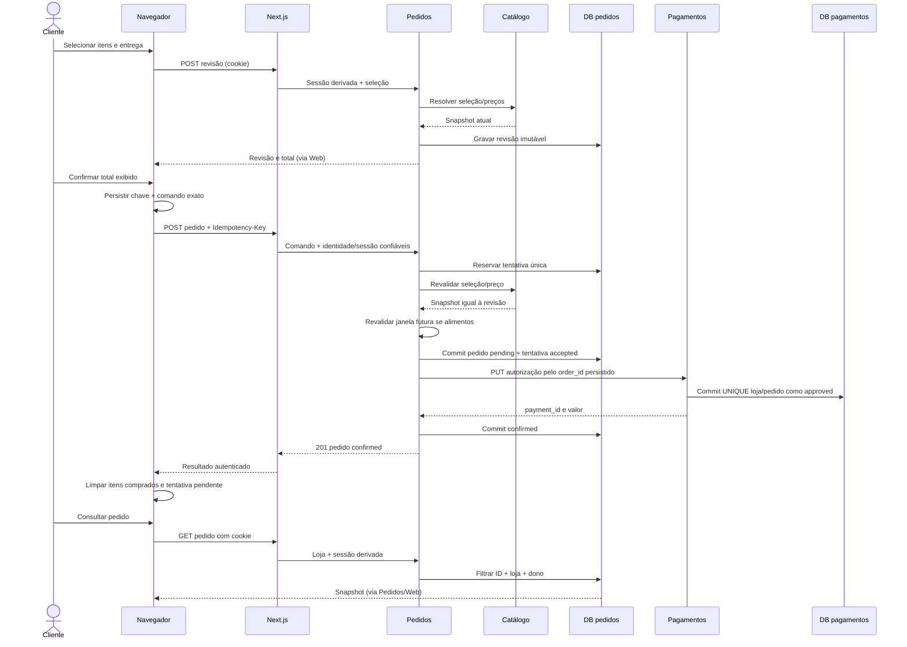

# Reenvios, persistência e recuperação

Especificação da etapa 2. Na etapa 3 foram preparados bancos privados, campos/constraints e transações de infraestrutura, conforme [fundacao-etapa3.md](fundacao-etapa3.md). **O fluxo, os métodos de negócio e o worker deste documento não foram implementados.** Fluxo-alvo proporcional ao MVP, sem broker, transação distribuída ou promessa de processamento exatamente uma vez. APIs e tempos: [contratos-api.md](contratos-api.md).

Nota 5A: criação de **revisão** persistida e janela interna existem agora, conforme [revisao-etapa5a.md](revisao-etapa5a.md). Não existem consumo/admissão, tentativa idempotente, pedido, autorização ou recuperação. Revisão não é pedido nem trava de preço/estoque. Reenvio do POST de revisão pode gerar nova revisão; não reutilizar a semântica da futura chave de pedido como se já estivesse implementada.

## Invariantes e escopo

1. Nenhuma chamada de autorização ocorre antes de o pedido e seu snapshot estarem gravados.
2. Uma tentativa é identificada por `(store_id, session_owner, idempotency_key)`, com restrição UNIQUE no banco de pedidos. A chave é aleatória gerada pelo navegador antes da primeira confirmação, não por tentativa HTTP.
3. Uma revisão é consumida por no máximo um pedido: UNIQUE(review_id), além de UNIQUE(attempt_id). Isso também impede duplicação por duas abas que usem chaves diferentes para a mesma revisão.
4. Uma autorização é identificada por `(store_id, order_id)`, UNIQUE no banco de pagamentos. Todos os reenvios usam o mesmo order_id, método, moeda e total persistido.
5. Repetição nunca altera snapshot, valor, dono ou identidade de um pedido. Bancos e registros pertencem à loja configurada, não ao store_id livremente enviado pelo cliente.
6. Registros de idempotência/autorização não expiram no MVP. Recriar banco ou apagar volume elimina essas garantias e não é um reinício normal.

O navegador persiste uma tentativa mínima em `lps:checkout:v1:<store_id>` antes do POST: chave, corpo exato `{store_id, review_id}`, revisão do carrinho (digest das seleções), config_hash, session_context_id público sem poder de autenticação, order_id quando conhecido e instante. Não guardar endereço, cookie ou credencial. O corpo não deve ser reconstruído de um carrinho que mudou. Permitir uma tentativa pendente por loja na UI; backend continua protegido contra concorrência e múltiplas abas.

Em reload/timeout, conferir continuidade da sessão pelo session_context_id e, com a mesma sessão, consultar tentativa pela chave. Se o ID do pedido for conhecido, consultar pedido. Um pedido de outra sessão não pode ser recuperado pela chave, mesmo que alguém a conheça. Ao perder cookie ou mudar o contexto, não reenviar a tentativa sob uma sessão nova; explicar a perda de acesso, preservar carrinho e não prometer deduplicação entre identidades distintas. Não há recuperação de conta no MVP.

## Canonicalização e mesma chave

Criar request_hash SHA256 de JSON canônico do comando estrito aceito: store_id e review_id, com chaves ordenadas, sem espaços. O dono está no escopo da restrição, não no corpo. Hash não inclui headers voláteis/request_id; persistir também comando normalizado para auditoria interna. Conteúdo com campos extras é rejeitado antes de tentar processar. Comparar hash antes de qualquer efeito externo.

| Situação | Resultado |
|---|---|
| Mesma chave e comando normalizado idêntico | Retornar rejeição persistida, mesmo pedido ou estado validating; nunca criar outra compra |
| Mesma chave e outro review_id/store no mesmo contexto válido | 409 IDEMPOTENCY_KEY_REUSED; sem tocar no registro original. Store de corpo diferente da loja é rejeitado antes como CONFIG_MISMATCH |
| Duas requisições simultâneas com mesma chave | INSERT transacional + UNIQUE escolhe uma tentativa; a perdedora lê a existente, compara hash e responde 202/resultado |
| Duas chaves para mesma revisão | UNIQUE(review_id) no momento de admissão escolhe um pedido; perdedora persiste rejeição REVIEW_ALREADY_USED com ID apenas para o dono |
| Mesma chave após rejeição de preço/agenda/revisão | Mesma rejeição, sem nova validação/compra; usuário gera nova revisão e nova chave após corrigir |
| Chave não encontrada após timeout | Repetir o mesmo POST/corpo/chave; não trocar a chave, pois a primeira chamada pode ainda estar em trânsito |

Validação sintática (JSON, schema, sessão, chave ausente) pode rejeitar antes de reservar a chave, sem efeitos. Depois da reserva, erros de negócio definitivos são persistidos. Erro transitório não é rejeição definitiva. Reenvio consulta registro existente antes de avaliar expiração de revisão: uma compra já admitida não expira porque a resposta se perdeu.

## Estados duráveis

Tentativa: `validating → rejected` ou `validating → accepted`. Accepted aponta para o pedido; rejected guarda status HTTP/código/campos seguros para resposta repetida. Timeout/indisponibilidade durante validação mantém validating com contador/next_retry_at, não cria autorização.

Pedido: `payment_pending → confirmed` quando resultado observado e commit local feito. Pending pode virar `payment_unknown` após falha/timeout; unknown pode voltar ao trabalho de recuperação e virar confirmed, sem criar novo ID. Ambos podem ir a `payment_conflict` em violação definitiva de invariantes, como autorização com outro valor. Conflict permanece para investigação; não é recusa bancária nem autorização para cobrar outra vez. `confirmed` é terminal nesta versão.

Pagamento: registro atomicamente criado como `approved`. Não existe estado persistido pendente no simulador: autorização é inserir decisão determinística local. Se o chamador não sabe se o commit ocorreu, ele observa “unknown” no pedido; só GET/PUT pelo order_id resolve. Não modelar timeout como recusa ou estorno.

## Algoritmo de admissão e autorização

1. Web valida sessão/origem e encaminha cabeçalhos confiáveis, chave e comando. Pedidos confere identidade, schema e formato de chave.
2. Em transação curta, buscar/criar tentativa validating com request_hash e comando, limitada por UNIQUE. Registrar lease/versão e contador antes do trabalho. Se existe e não corresponde, 409; se rejeitada, repetir erro; se aceita, retornar estado do pedido e, se aplicável, sinalizar recuperação. Nunca manter a transação aberta durante HTTP.
3. Para nova tentativa/validação recuperada: carregar revisão por loja/sessão; validar hash/configuração, expiração, entrada e agenda; resolver catálogo com timeout. Imediatamente antes da admissão, verificar novamente que revisão e início da janela ainda são futuros, usando relógio do servidor. Comparar snapshot comercial atual com revisão. Expiração/alteração vira rejected com erro correspondente. Dependência inacessível mantém validating e agenda retry; responder 503 se não há pedido, ou 202 quando há processamento da própria tentativa em curso sem falha atual.
4. Em **uma transação local**, conferir lease/versão, revisão ainda não consumida, criar order_id, gravar snapshot completo, estado payment_pending e pedido vinculado à revisão; atualizar tentativa para accepted apontando para o pedido. Confirmar commit antes de chamar pagamentos. Em falha/commit incerto, não autorizar: reler pela chave/revisão em recuperação. Unicidade resolve concorrência. Se o lease foi perdido, resultado remoto de validação é descartado e o titular atual decide.
5. Usar exclusivamente total/moeda/método/order_id do pedido gravado para PUT de pagamento. Pagamentos, em transação própria, insere UNIQUE(store,order) e decisão approved; se já existe, compara request_hash e retorna o mesmo registro; divergência retorna 409. Resposta só após commit durável.
6. Pedidos confere loja, order_id, moeda, método e valor da autorização. Em transação curta com CAS, grava payment_id e confirmed. Só depois devolver sucesso. Se não for possível confirmar o estado local, não mostrar confirmação; manter/reconstruir pending/unknown e recuperar. Workers não podem regredir confirmed para unknown.

Em etapa 3 de esqueleto, modelar tabelas/invariantes sem antecipar a implementação deste fluxo completo. Critérios de recuperação serão exercitados nas etapas de compra, não declarados cumpridos ao criar o schema.

## Worker e repetição limitada

Um loop interno de pedidos varre validating e pedidos payment_pending/payment_unknown. Inicialmente um processo/worker de servidor; ainda assim, usar aquisição de lease via transação/CAS: duração 15 s, versão crescente, atualização só pelo titular com versão atual. Orçamento de trabalho por tentativa ≤ 8 s. Em reinício, leases não expirados aguardam até expirar; serviço não zera leases alheios arbitrariamente.

Recuperação da autorização começa com GET por order_id. Se approved, gravar confirmed; se 404, PUT com a mesma identidade e valor; se GET falha/timeout, não assumir 404 e aguardar próxima tentativa. Um PUT anterior atrasado pode completar depois do GET 404: UNIQUE e comparação de hash continuam impedindo segunda autorização. Erros transitórios incrementam contadores persistidos; conflito definitivo vira payment_conflict e interrompe retomada automática.

Máximo de cinco execuções de trabalho por ciclo, incluindo a primeira (chamada direta e worker compartilham contador), com intervalos mínimos 2, 4, 8 e 16 s após falhas; sem loop infinito e sem dormir segurando request/transação. Depois disso, manter estado intermediário e recovery.action `retry_same_key`, com next_retry_at de pelo menos 30 s após a última execução. GET nunca reinicia ciclo. POST com mesma chave e corpo, após cooldown, reativa um ciclo limitado; se confirmed/rejected, apenas retorna resultado. Cliques durante lease/cooldown só retornam estado. Reinício não zera contador/cooldown; retoma trabalho não esgotado e recupera leases, não cria tentativas novas. Storage indisponível impede adquirir lease/incrementar contador e é mostrado como 503, sem efeitos externos novos.

Esta política permite recuperação eventual quando os serviços voltarem e houver ciclo/retomada; não promete prazo de conclusão nem repetição automática ilimitada. Sessão expirada não cancela recuperação de uma compra já admitida: o worker usa identidade persistida, sem depender do cookie do navegador. Acesso do usuário continua sujeito à sessão original.

## Falhas e resposta esperada

| Ponto da falha | Registro durável possível | Recuperação/resultado |
|---|---|---|
| Antes de reservar tentativa | Nenhum | Mesmo POST/chave pode reservar; GET pode ser 404 |
| Após reservar, antes de validar catálogo | validating | Reenvio/worker revalida; se revisão expirou sem admissão, rejeitar e pedir revisão nova |
| Catálogo cai na revisão/admissão | Revisão antiga e/ou validating | Sem pagamento; 503 ou 202 de concorrência; retry limitado com mesma chave |
| Gravação da admissão falha/commit incerto | Nenhum pedido ou pedido+accepted atômicos | Não enviar PUT; reler chave/revisão, evitando criar outra ordem |
| Pedido gravado, processo cai antes do PUT | payment_pending | Worker GET pagamento; se 404, PUT com mesmo order_id |
| PUT não chega ou falha antes de commit | Pedido pending/unknown, pagamento ausente | GET 404 permite mesmo PUT; aprovação só uma vez por restrição |
| Commit de pagamento ocorre, resposta se perde | Pagamento approved, pedido pending/unknown | GET encontra a mesma autorização; atualizar pedido |
| PUT ainda em trânsito quando GET retorna 404 | Registro remoto pode surgir depois | PUT repetido disputa UNIQUE; ambas respostas referem-se ao mesmo payment_id |
| Falha ao gravar confirmed | Pagamento approved; pedido ainda intermediário ou commit incerto | Consultar/repetir recuperação e fazer CAS; nunca nova autorização por outro ID |
| Confirmed gravado, resposta do pedido se perde | Pedido confirmed | GET por chave encontra order_id; GET pedido mostra sucesso |
| Pagamento ou pedidos reinicia | Estados gravados preservados | Metadados validam loja/schema; leases e contadores permitem retomada sem reseed |
| Valor remoto conflitante | Autorização divergente | Persistir payment_conflict se possível; mostrar investigação, não refazer compra automaticamente |
| Janela passa enquanto pagamento está incerto | Pedido já possui snapshot válido de admissão | Recuperar o mesmo pedido; não invalidar nem reagendar depois de autorizado |

Agenda é validada para admissão; pode haver atraso de confirmação depois do início da janela. Como não há execução logística, UI informa a janela registrada e eventual atraso na confirmação, sem garantir entrega ou reagendar silenciosamente.

## Carrinho, resposta perdida e controle do usuário

Antes de confirmar, persistir tentativa e congelar a seleção daquela compra. Em timeout/pending/unknown, manter carrinho e tentativa, bloquear novo checkout dos mesmos itens e oferecer consulta/retomada; não gerar chave nova. Consultar chave até obter pedido ou rejeição; até seis consultas automáticas espaçadas, depois ação explícita.

Limpar somente ao observar `confirmed` pela resposta ou consulta autenticada, nunca no clique, 202, autorização isolada ou erro 503. Remover apenas as quantidades da revisão se a versão do carrinho ainda corresponde; se outra aba alterou carrinho, pedir reconciliação e não apagar novos itens. Persistir referência de último pedido confirmado para reabrir consulta sem conservar uma tentativa pendente. Se rejected, desbloquear edição, invalidar revisão/chave daquele envio e solicitar nova revisão/confirmação. Em payment_conflict, preservar referência e bloquear repetição automática; não oferecer outro pagamento como correção silenciosa.

## Sequência da compra normal



## Sequência de timeout, reenvio e recuperação

```mermaid
sequenceDiagram
    participant UI as Navegador
    participant W as Next.js
    participant O as Pedidos / worker
    participant DB as DB pedidos
    participant P as Pagamentos
    participant PD as DB pagamentos
    UI->>W: POST pedido, chave K
    W->>O: K + mesmo review_id + sessão
    O->>DB: Reservar K e admitir pedido Q
    O->>P: PUT pagamento de Q
    P->>PD: Commit approved com UNIQUE loja/Q
    P--xO: Resposta perdida / timeout
    O->>DB: Manter Q pending ou gravar unknown
    O--xUI: Resposta original não chega
    UI->>W: GET tentativa K
    W->>O: Consultar K da sessão
    O->>DB: Ler K e Q
    O-->>UI: accepted, Q, estado intermediário (via W)
    par Retomada do cliente
        UI->>W: POST mesmo K e comando
        W->>O: Repetir K
        O->>DB: Ler registro único; não criar outro Q
    and Recuperação com lease
        O->>DB: Adquirir lease/CAS de Q
        O->>P: GET pagamento por Q
        P->>PD: Ler autorização durável
        P-->>O: Mesmo payment_id approved
        O->>DB: Commit Q confirmed
    end
    O-->>UI: Q ou 202 conforme instante (via W)
    UI->>W: GET pedido Q
    W->>O: Q + sessão
    O-->>UI: confirmed e snapshot (via W)
    UI->>UI: Limpar somente itens confirmados
```

O diagrama ilustra uma aprovação persistida cuja resposta foi perdida. No ramo sem aprovação, GET 404 seguido de PUT usa o mesmo Q, sem novo efeito duplicado. A concorrência é resolvida pelo banco, não por confiar que o cliente só clicará uma vez.
